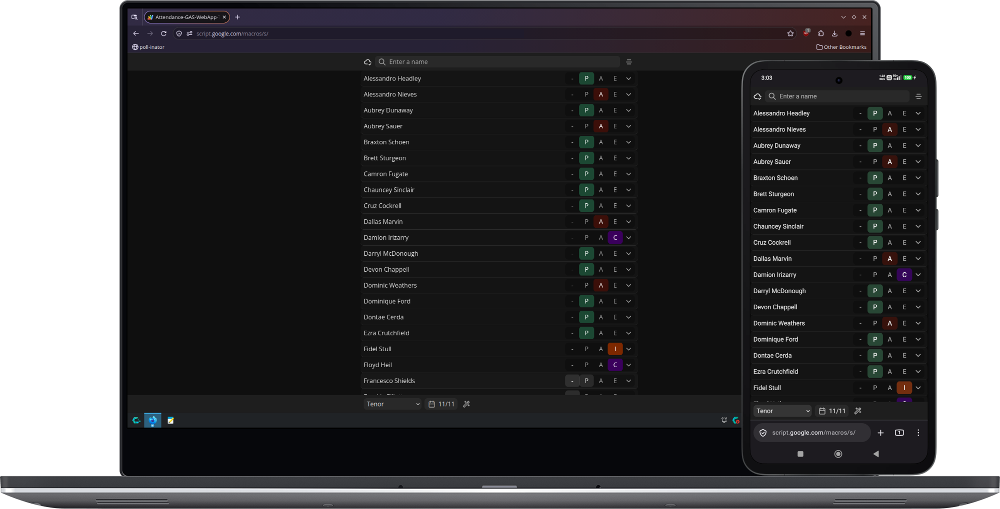
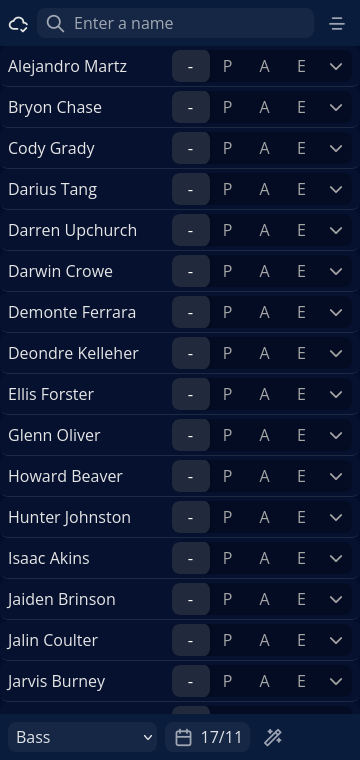
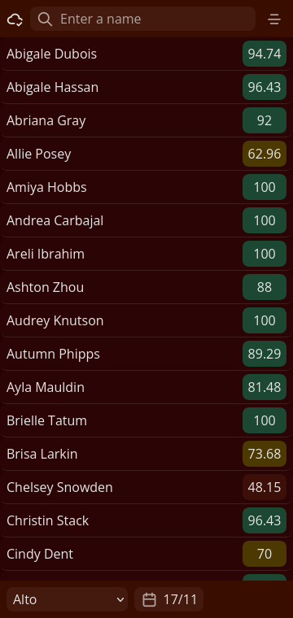
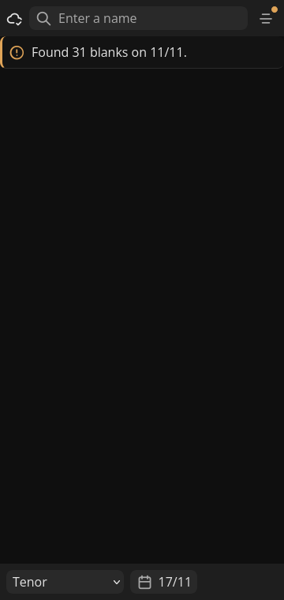

# Attendance GAS WebApp Template

[Key Features](#key-features) • [Demo](#demo) • [Setup](#setup)

## Key Features

- Mark attendance as P, A, E, M, I or C for every member, by section and date.
- Switch between Attendance, Percentage and Issues views from the menu.
- Shows each member's attendance percentage, colour-coded as healthy, warning or critical.
- Lists dates with unmarked members under Issues.
- Fill all blanks for a date with a single value.
- Search members by name.
- Each section gets its own theme colour.
- Changes are saved in the background and the app warns before closing with unsaved changes.
- Works on phones and desktops.

## Demo

<table>
  <tbody>
    <tr>
      <td>
        
      </td>
      <td>Mark attendance</td>
    </tr>
    <tr>
      <td>
        
      </td>
      <td>View percentages</td>
    </tr>
    <tr>
      <td>
        
      </td>
      <td>Spot issues</td>
    </tr>
  </tbody>
</table>

## Setup

1. Click [this link](https://docs.google.com/spreadsheets/d/1bJE2JL2DUOroMPSa0QUhqsZfh36WFVfYCbuGn53aBA0/) to open the Google Sheet.
2. Click "File" > "Make a copy" (this also copies the Apps Script project).
3. Delete all the sheets except "Soprano".
4. Delete all the names on the remaining sheet.
5. Change the date in the first date column.
6. Right-click the sheet's tab and choose "Duplicate" once for each section.
7. Rename each sheet to the name of its section.
8. Add the members' names to each sheet.  
Optional: To give each section a colour theme, right-click a sheet's tab and choose "Change colour".
10. Click "Extensions" > "Apps Script".
11. Click "Deploy" > "New deployment" and select "Web app" as the type.
12. Set "Execute as" to "Me", set "Who has access" to whoever should use the app and click "Deploy".
13. Authorise the script when asked and open the web app URL.

(Create a new version of the deployment after every change, otherwise the URL will keep serving the old code.)
